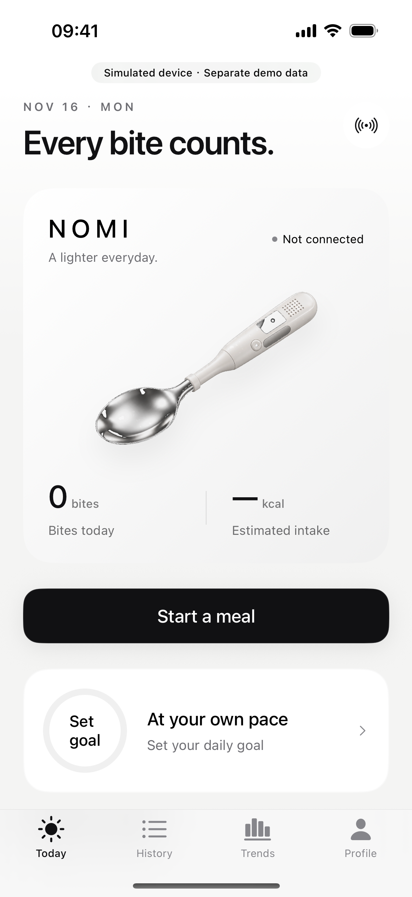
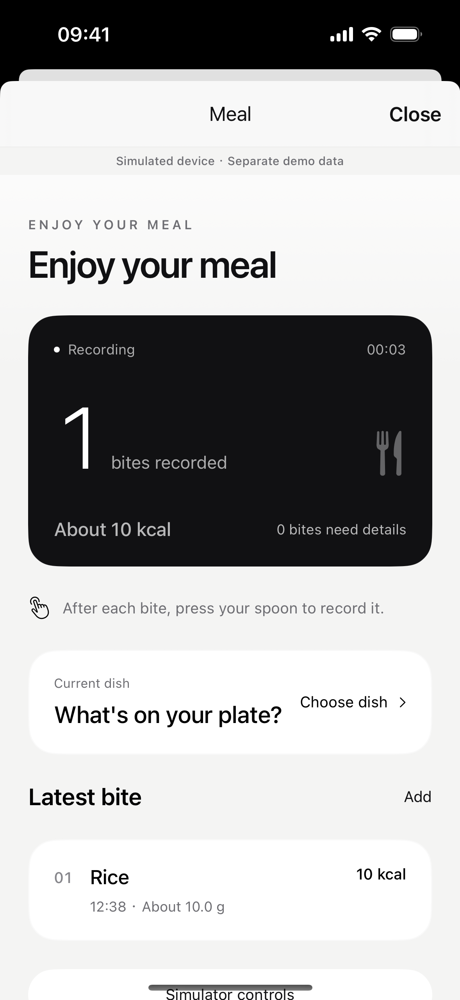
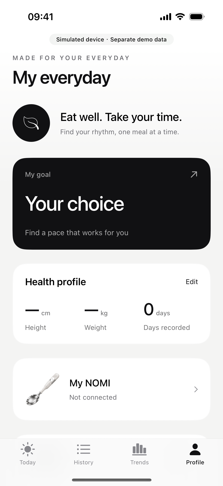
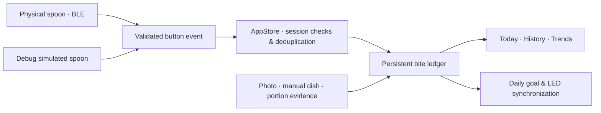

<div align="center">

# GRAMO_APP

### Every bite counts.

A native iOS companion for a smarter spoon — built around meals, not dashboards.


[Get started](#get-started) · [Simulator demo](#try-a-meal-without-hardware) · [Architecture](#how-it-works) · [中文说明](#中文说明)

</div>

---

## A little more awareness with every meal

GRAMO_APP brings your spoon, meal history and daily goal into a calm, monochrome interface. Record a bite after eating, review what you ate, and fill in missing details when you have time.

<table>
  <tr>
    <td align="center"><br><b>Today</b><br>Your meal, at a glance.</td>
    <td align="center"><br><b>During a meal</b><br>Stay present. Keep a record.</td>
    <td align="center"><br><b>Your everyday</b><br>A goal that belongs to you.</td>
  </tr>
</table>

<sub>Actual iOS Simulator screenshots. The visible simulation label identifies isolated demonstration data, not real intake.</sub>

### Designed for everyday use

- **A clear daily view.** Bite count, estimated intake, goal progress and recent meals.
- **A record you can correct.** Review, supplement or delete a bite; totals recalculate from the same ledger.
- **Trends with context.** Seven- and thirty-day views; missing records are not treated as zero intake.
- **English and 简体中文.** English by default. Switch in **Profile → Language**; your choice survives restart.
- **Press-first recording.** During a meal, a short press saves the bite immediately. With the local evaluation model installed, recent spoon-camera images automatically supply a provisional dish name; manual selection is an optional correction. Missing weight never becomes invented calories.
- **A separate development space.** Debug controls, protocol diagnostics and simulated records stay out of the ordinary consumer experience.

## Get started

### Requirements

- macOS with Xcode and the iOS SDK installed.
- An **iOS 18 or newer** iPhone simulator runtime.
- Python 3 for the convenience launcher. The native app has no third-party Swift package or CocoaPods installation step.

```sh
git clone https://github.com/JJZHANG0/CONRAD_GRAMO_IOSAPP.git GRAMO_APP
cd GRAMO_APP
./tools/run_simulator_demo.sh
```

The launcher selects an available iPhone simulator, builds the Debug app, installs it and opens **isolated simulated-device mode**. It preserves existing demo records. To choose a specific simulator:

```sh
xcrun simctl list devices available
GRAMO_SIM_ID="YOUR_SIMULATOR_UDID" ./tools/run_simulator_demo.sh
```

**Prefer Xcode?** Open [`GRAMO_APP.xcodeproj`](GRAMO_APP.xcodeproj), select the **GRAMO_APP** scheme and an iPhone simulator, then run. Add `-mock-device` under **Scheme → Run → Arguments** for the hardware-free demo. Without this argument, the app opens in ordinary consumer mode.

The project retains its existing signing configuration. Simulator builds need no device provisioning. For a physical iPhone, use your own development team and provisioning settings.

## Try a meal without hardware

1. Open **Start a meal** → **Simulator controls**.
2. Select **Connect / sync simulated device**, then **Start simulated meal**.
3. Press **Short press · Release** once: one event creates one bite. Replay the event: the total stays unchanged. A second independent press adds a second bite.
4. Long-press power off/on: no bite is added. Disconnect, short-press, then reconnect to demonstrate queued synchronization.
5. Turn off **Provide simulated portions**: the next bite stays incomplete, without invented grams or calories.
6. Set the test goal to **20 kcal**. With the arithmetic fixture enabled, two 10 kcal bites reach the simulated red state. Correct the total below the goal to return to green.
7. Visit History, Trends and Profile. Relaunch the app: your records and language choice remain.

The fixture's **10 g × 100 kcal/100 g = 10 kcal** exists only to test arithmetic; it is not nutrition information. To reproduce the sequence from zero, explicitly clear **isolated demo records** in the simulator controls first.

<details>
<summary><b>Debug access and data separation</b></summary>

In a Debug build, long-press the **NOMI** wordmark at the bottom of Profile for three seconds to open developer tools. You can also use `-developer-mode`. Switch off simulated-device mode to return to the original records.

| Environment | Storage | Hardware access |
|---|---|---|
| Ordinary app | Existing local user ledger | Core Bluetooth when requested |
| Simulated device | Separate preferences suite and `Documents/Simulation` | No real BLE commands |
| Automated tests | Dedicated test suites | Replay and mock adapters |

Mock controls and diagnostic screens are compiled only in Debug. Language is a shared display preference; switching it never translates or rewrites stored meal records.

</details>

## How it works



**Short press records; long press controls power.** Each bite has a device/event identity. Retransmission does not add another bite, and a replay does not resurrect a deleted record. Image capture alone does not record intake.

**Evidence stays honest.** A missing dish, weight or sourced energy density remains incomplete. Calculable bites use `grams × kcal per 100 g ÷ 100`. Finishing a meal does not count it twice. Daily totals follow the local calendar and refresh after edits, reconnects and foreground transitions.

**The rename preserves continuity.** The project, targets, modules and app product are now `GRAMO_APP`. The existing Bundle ID (`com.kanglaide.zhiweishao`), storage keys, signing settings and Git history remain intact. NOMI/NOMI01 still identify the existing product artwork and prototype hardware.

### Repository map

```text
GRAMO_APP.xcodeproj/       Xcode project and shared scheme
GRAMO_APP/
├── Model/                Ledger, BLE protocol, recognition, localization, mocks
├── Views/                Native SwiftUI consumer and Debug flows
├── Assets.xcassets/      Existing product visuals
└── Theme.swift           Shared visual system
GRAMO_APPTests/            Business, protocol, image and language tests
GRAMO_APPUITests/          Simulator interaction and screenshot tests
firmware/                 Documented ESP32-S3 integration firmware
tools/                   Model export, simulator launcher and bench utilities
docs/                    Architecture, protocol, evidence and setup notes
```

## Build and test

Use **Product → Test** in Xcode, or select an installed simulator from `xcrun simctl list devices available`:

```sh
xcodebuild -project GRAMO_APP.xcodeproj -scheme GRAMO_APP \
  -destination 'platform=iOS Simulator,id=YOUR_SIMULATOR_UDID' test

xcodebuild -project GRAMO_APP.xcodeproj -scheme GRAMO_APP \
  -configuration Release -destination 'generic/platform=iOS Simulator' \
  CODE_SIGNING_ALLOWED=NO build
```

The verified suite covers **35 unit/model tests and 6 simulator UI tests**: event deduplication, independent presses, long-press exclusion, missing evidence, offline replay, correction/deletion, exact goal thresholds, local-day rollover, persistence and English/Chinese switching. See [button reliability and local-model verification](docs/button-and-local-model-fix.md) for the latest run.

## Recognition and hardware status

| Area | Available | Boundary |
|---|---|---|
| Native app & simulator | Full recording, editing, goals, history, trends and bilingual demo | Simulation is explicitly labeled |
| Core ML | Replaceable recognizer, pinned export script, preprocessing and parity evidence | Model weights are **not included**; manual dish entry works without them |
| BLE & spoon camera | Existing protocol, JPEG frame assembly and prototype integration | Physical-device evidence is documented separately from simulator tests |
| Physical button | Firmware gesture handling and app event pipeline | On-device acceptance remains distinct from mock validation |
| Physical LED | Goal commands, acknowledgments and simulated threshold tests | The prototype strip remained dark; a command acknowledgment is not proof of visible light |
| Portion measurement | Validated-input algorithms and manual entry | No uncalibrated visual area is converted to grams |

The optional evaluation model is [Albertbeta123/resnet-50-chinese-food](https://huggingface.co/Albertbeta123/resnet-50-chinese-food), pinned to a specific revision. Export instructions, model/data rights and placement are in [model evaluation](docs/model-evaluation.md). Debug builds compile an existing local `artifacts/chinese-food/ChineseFood.mlpackage` into the app. Weights are not downloaded automatically or committed to this repository. Release does not bundle this evaluation resource or load an external Debug package. The latest local benchmark measured about 0.12 seconds for a 640×480 spoon-camera sample on the test iPhone; see the [performance evidence and limitations](docs/button-and-local-model-fix.md).

## Documentation

| Guide | Contents |
|---|---|
| [Product experience](docs/product-experience.md) | Screens, language settings, mode boundaries and simulator walkthrough |
| [Build & acceptance](docs/integration-test-plan.md) | App validation and separate physical-device steps |
| [Hardware evidence](docs/hardware-integration.md) | Source-confirmed, device-verified and unresolved findings |
| [NOMI protocol](docs/nomi-protocol.md) | Camera frames, button events and LED commands |
| [Model evaluation](docs/model-evaluation.md) | Export, preprocessing, labels, parity and licensing constraints |
| [Free Colab pilot](docs/colab-training.md) | Reproducible, isolated small-scale food-model fine-tuning |
| [Cuisine image dataset](docs/cuisine-dataset.md) | Public-image collection, attribution, quarantine and review gates |
| [Firmware](firmware/README.md) | Known board, build instructions and recovery boundaries |
| [Third-party notes](THIRD_PARTY_NOTICES.md) | Model sources and distribution scope |

## 中文说明

**GRAMO_APP 是智能餐勺的原生 iOS 配套应用。** 黑白极简界面，围绕每天的用餐、逐口记录、趋势与个人目标设计。

- 默认英语，在 **Profile → Language → 简体中文** 切换；中文界面可通过 **我的 → 语言 → English** 切回。选择会保存。
- 打开 **GRAMO_APP.xcodeproj**，选择 **GRAMO_APP** scheme。运行 `./tools/run_simulator_demo.sh` 即可在电脑模拟器体验，不依赖实体餐勺。
- 模拟短按、长按、重发与断线补传复用真实业务链路。模拟记录与真实数据隔离；缺少菜名、份量或营养来源时保留待完善。
- 更名保留原 Bundle ID、签名配置、数据存储键与 Git 历史。现有界面的 NOMI 产品素材和 NOMI01 硬件名称继续沿用。
- 模型权重、固件完整备份、原始私有附件、个人配置及构建产物不在仓库内。照片识别需要单独准备允许使用的模型；没有模型也能手动记录。
- 实体灯带此前未通过亮灯验收，模拟器红绿状态不能代替硬件验收。详见上方文档。

---

<sub>This repository does not grant a blanket open-source license to all code, artwork, model weights or datasets. See third-party notes and obtain the applicable rights before redistribution or commercial use.</sub>
